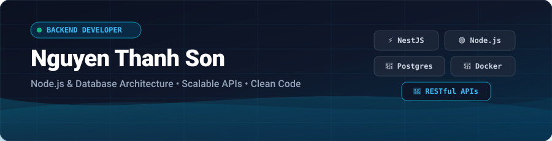

<p align="center">
  
</p>

<p align="center">
  <a href="https://readme-typing-svg.demolab.com">
    
  </a>
</p>

<p align="center">
  <a href="https://portfolio-cua-son.vercel.app/" target="_blank">
    
  </a>
  <a href="mailto:nguyensonn2805@gmail.com">
    
  </a>
  <a href="https://github.com/nguyenthanhsonn" target="_blank">
    
  </a>
  
</p>

---

### 👨‍💻 About Me

```yaml
name: Nguyen Thanh Son
role: Backend Developer
location: Da Nang City, Vietnam 🇻🇳
focus: Scalable RESTful APIs, Backend Architecture & DB Performance
learning: NestJS, System Architecture, FastAPI
interests: Clean Code, Software Architecture, Music 🎧 & Gaming 🎮
```

- 🌍 **Location:** Based in **Da Nang City, Vietnam**
- 💼 **Primary Focus:** Specializing in **Node.js, Express, and NestJS** for reliable and high-performance backend systems.
- 🗄️ **Data & Architecture:** Designing efficient database schemas & query optimization across **SQL (PostgreSQL, MySQL) & NoSQL (MongoDB)**.
- 🧠 **Currently Leveling Up:** NestJS, System Architecture, Performance Tuning & FastAPI.
- 💬 **Ask Me About:** Backend API design, database indexing, caching strategies, or tech banter!
- 🕹️ **When Offline:** You'll probably find me listening to good music or playing games 🎮.

---

### 🛠️ Tech Stack & Skills

<p align="center">
  <a href="https://skillicons.dev">
    
  </a>
</p>

<details open>
<summary><b>Detailed Breakdown by Category</b></summary>
<br />

| Category | Technologies |
| :--- | :--- |
| **Languages** |      |
| **Frameworks & Runtimes** |     |
| **Databases & Cloud** |     |
| **DevOps & Tooling** |      |
| **Design & Communication** |    |

</details>

---

### 📊 GitHub Analytics

<p align="center">
  
</p>

<p align="center">
  
  
</p>

---

<p align="center">
  <i>💡 "First, solve the problem. Then, write the code." — John Johnson</i>
</p>

<p align="center">
  Designed with ❤️ by <a href="https://github.com/nguyenthanhsonn">Nguyen Thanh Son</a>
</p>
